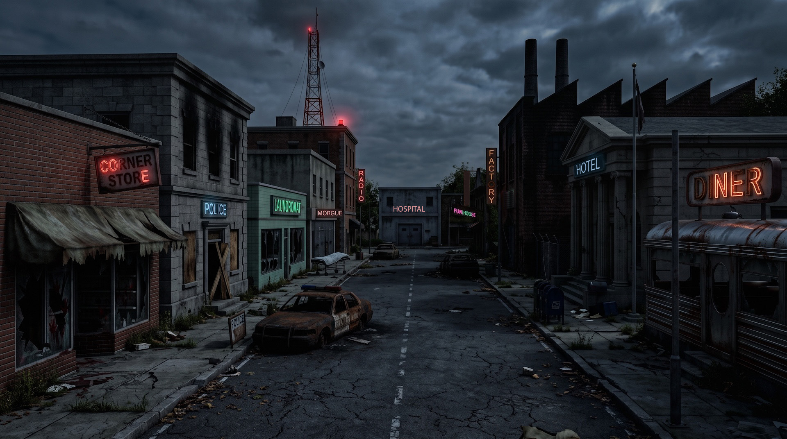

# Zombie

Zombie is a game that teaches programming. The world has ended, the streets belong to the undead, and the only way to survive is to learn to code. Players explore an abandoned street, clear buildings room by room, and fight zombies by writing and fixing real code.

## How to Run the Game

### Requirements

- [Python 3.12](https://www.python.org/downloads/)
- [Node.js](https://nodejs.org/) (includes `npm`)

### First-time setup

Run these commands from the repository root.

**macOS / Linux**

```bash
cd project
python3 -m venv .venv
source .venv/bin/activate
pip install -r requirements.txt
npm install
npm run build
python manage.py migrate
python manage.py runserver
```

**Windows (PowerShell)**

```powershell
cd project
python -m venv .venv
.venv\Scripts\Activate.ps1
pip install -r requirements.txt
npm.cmd install
npm.cmd run build
python manage.py migrate
python manage.py runserver
```

Then open **http://127.0.0.1:8000/** in your browser to play.

### Playing again later

You only need to do the setup once. After that, start the game with:

**macOS / Linux**

```bash
cd project
source .venv/bin/activate
python manage.py runserver
```

**Windows (PowerShell)**

```powershell
cd project
.venv\Scripts\Activate.ps1
python manage.py runserver
```

Press `Ctrl+C` in the terminal to stop the server.

> If you pull new changes, run `pip install -r requirements.txt`, `npm install`, `npm run build`, and `python manage.py migrate` again before starting the server.

### Optional: AI tutor

The in-game tutor uses [Groq](https://console.groq.com/). To turn it on, set your API key before running the server:

```bash
export GROQ_API_KEY=your-key-here          # macOS / Linux
```

```powershell
$env:GROQ_API_KEY = "your-key-here"        # Windows (PowerShell)
```

The rest of the game works without it.

## Running Tests

Run these commands from the `project` folder:

```bash
cd project
pytest        # Python tests
npm test      # JavaScript tests (Vitest); use npm.cmd test on Windows
```

To run a single JavaScript test file:

```bash
npx vitest run jstests/blockly_integer_input.test.js
```

## The Street

The game’s hub is a ruined street lined with ten buildings. Each building is dedicated to one programming concept, such as loops, conditional statements, or inheritance. The player picks a building and enters it to begin.

<p align="center">
  <br>
  <em>The Street</em>
</p>

## Buildings and Rooms

- Every building has four or more rooms, and each room teaches one topic within that building’s concept.
- Every room contains one tutorial and one or more coding exercises.
- Exercises are hidden in the scene: the player clicks objects in the room, such as a flickering terminal, a radio, or a survivor’s journal, to activate them.
- Each room has a door that leads to the next room once the player is ready.

## Zombies

**The Jumpscare Zombie:** Hidden in one room of every building, this zombie bursts out without warning. To survive, the player must quickly debug broken code.

**The Boss Zombie:** Waiting in the final room of every building, the boss is defeated by writing code that uses everything the player learned in that building’s rooms.

## Building Map

| # | Building | Concept | Room 1 | Room 2 | Room 3 | Room 4 | Boss Room | Jump Scare | Total |
|---|---|---|---|---|---|---|:-:|:-:|:-:|
| 1 | The Corner Store | Variables & Data Types | Variables Room | Data Types Room | Operators Room | - | 1 | 1 | 5 |
| 2 | The Police station | Conditionals | If/Else Room | Else-If | Switch Room | Logic Room | 1 | 1 | 6 |
| 3 | The Laundromat | Loops | For Room | While Room | Do-While Room | - | 1 | 1 | 5 |
| 4 | The Morgue | Arrays | Indexing Room | Traversal Room | Modifying Room | - | 1 | 1 | 5 |
| 5 | The Radio Station | Strings | Concatenation Room | Indexing | Slicing Room | Methods Room | 1 | 1 | 6 |
| 6 | The Diner | Functions | Define & Call Room | Parameters & Return Room | Scope Room | - | 1 | 1 | 5 |
| 7 | The Hotel | Dictionaries / Maps | Key-Value Room | Updating Room | Iteration Room | - | 1 | 1 | 5 |
| 8 | The Factory | Classes & Objects | Classes & Objects Room | Constructors & Methods Room | Inheritance Room | - | 1 | 1 | 5 |
| 9 | The Funhouse | Recursion | Base Case Room | Call Stack Room | Recursive Problems Room | - | 1 | 1 | 5 |
| 10 | The Hospital | Searching & Sorting | Linear Search Room | Binary Search Room | Sorting Room | - | 1 | 1 | 5 |
| | **TOTAL** | | **10** | **10** | **10** | **2** | **10** | **10** | **52** |

## Buildings

### 1. The Corner Store (Variables & Data Types)

<table>
  <tr>
    <td width="50%" align="center">
      <br>
      <em>Room 1: Variables</em>
    </td>
    <td width="50%" align="center">
      <br>
      <em>Room 2: Data Types</em>
    </td>
  </tr>
  <tr>
    <td width="50%" align="center">
      <br>
      <em>Room 3: Operators</em>
    </td>
    <td width="50%" align="center">
      <br>
      <em>Boss Zombie</em>
    </td>
  </tr>
</table>

### 2. The Police station (Conditionals)

<table>
  <tr>
    <td width="50%" align="center">
      <br>
      <em>Room 1: If/Else</em>
    </td>
    <td width="50%" align="center">
      <br>
      <em>Room 2: Else-If</em>
    </td>
  </tr>
  <tr>
    <td width="50%" align="center">
      <br>
      <em>Room 3: Switch</em>
    </td>
    <td width="50%" align="center">
      <br>
      <em>Boss Zombie</em>
    </td>
  </tr>
</table>

### 3. The Laundromat (Loops)

<table>
  <tr>
    <td width="50%" align="center">
      <br>
      <em>Room 1: For</em>
    </td>
    <td width="50%" align="center">
      <br>
      <em>Room 2: While</em>
    </td>
  </tr>
  <tr>
    <td width="50%" align="center">
      <br>
      <em>Room 3: Do-While</em>
    </td>
    <td width="50%" align="center">
      <br>
      <em>Boss Zombie</em>
    </td>
  </tr>
</table>

### 4. The Morgue (Arrays)

<table>
  <tr>
    <td width="50%" align="center">
      <br>
      <em>Room 1: Indexing</em>
    </td>
    <td width="50%" align="center">
      <br>
      <em>Room 2: Traversal</em>
    </td>
  </tr>
  <tr>
    <td width="50%" align="center">
      <br>
      <em>Room 3: Modifying</em>
    </td>
    <td width="50%" align="center">
      <br>
      <em>Jump Scare Zombie</em>
    </td>
  </tr>
</table>

### 5. The Radio Station (Strings)

<table>
  <tr>
    <td width="50%" align="center">
      <br>
      <em>Room 1: Concatenation</em>
    </td>
    <td width="50%" align="center">
      <br>
      <em>Room 2: Indexing</em>
    </td>
  </tr>
  <tr>
    <td width="50%" align="center">
      <br>
      <em>Room 4: Methods</em>
    </td>
    <td width="50%" align="center">
      <br>
      <em>Boss Zombie</em>
    </td>
  </tr>
</table>

### 6. The Diner (Functions)

<table>
  <tr>
    <td width="50%" align="center">
      <br>
      <em>Room 1: Define &amp; Call</em>
    </td>
    <td width="50%" align="center">
      <br>
      <em>Room 2: Parameters &amp; Return</em>
    </td>
  </tr>
  <tr>
    <td width="50%" align="center">
      <br>
      <em>Room 3: Scope</em>
    </td>
    <td width="50%" align="center">
      <br>
      <em>Boss Zombie</em>
    </td>
  </tr>
</table>

### 7. The Hotel (Dictionaries / Maps)

<table>
  <tr>
    <td width="50%" align="center">
      <br>
      <em>Room 1: Key-Value (Lobby)</em>
    </td>
    <td width="50%" align="center">
      <br>
      <em>Room 2: Updating (Stairwell)</em>
    </td>
  </tr>
  <tr>
    <td width="50%" align="center">
      <br>
      <em>Room 3: Iteration (Hallway)</em>
    </td>
    <td width="50%" align="center">
      <br>
      <em>Boss Zombie</em>
    </td>
  </tr>
</table>

### 8. The Factory (Classes & Objects)

<table>
  <tr>
    <td width="50%" align="center">
      <br>
      <em>Room 1: Classes &amp; Objects</em>
    </td>
    <td width="50%" align="center">
      <br>
      <em>Room 2: Constructors &amp; Methods</em>
    </td>
  </tr>
  <tr>
    <td width="50%" align="center">
      <br>
      <em>Room 3: Inheritance</em>
    </td>
    <td width="50%" align="center">
      <br>
      <em>Boss Zombie</em>
    </td>
  </tr>
</table>

### 9. The Funhouse (Recursion)

<table>
  <tr>
    <td width="50%" align="center">
      <br>
      <em>Room 1: Base Case</em>
    </td>
    <td width="50%" align="center">
      <br>
      <em>Room 2: Call Stack</em>
    </td>
  </tr>
  <tr>
    <td width="50%" align="center">
      <br>
      <em>Room 3: Recursive Problems</em>
    </td>
    <td width="50%" align="center">
      <br>
      <em>Boss Zombie</em>
    </td>
  </tr>
</table>

### 10. The Hospital (Searching & Sorting)

<table>
  <tr>
    <td width="50%" align="center">
      <br>
      <em>Room 1: Linear Search</em>
    </td>
    <td width="50%" align="center">
      <br>
      <em>Room 2: Binary Search</em>
    </td>
  </tr>
  <tr>
    <td width="50%" align="center">
      <br>
      <em>Microscope Lab</em>
    </td>
    <td width="50%" align="center">
      <br>
      <em>Jump Scare Zombie</em>
    </td>
  </tr>
</table>

---
