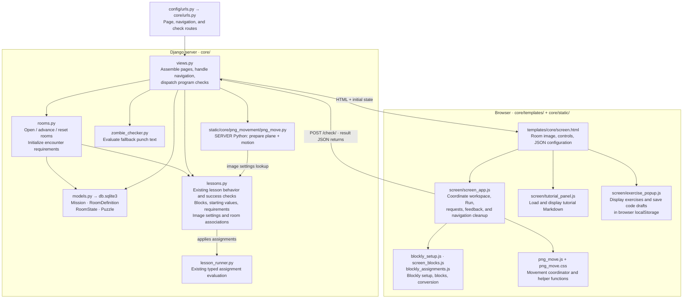
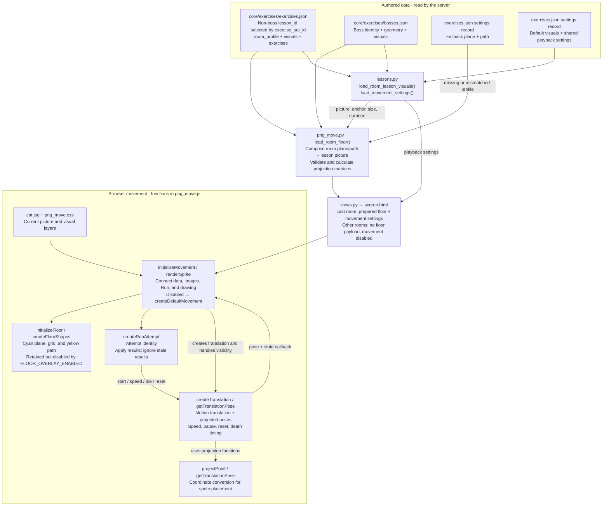

# Current code architecture

Snapshot of the working tree on October 30, 2026. This describes implemented code, including uncommitted changes. Paths below are relative to `project/`.

## The live game

Arrows show calls or the direction data travels; they are not all Python/JavaScript imports.



`main-menu.html` lists missions and links into this screen. Next/Exit forms submit workspace JSON to `views.py`; `Puzzle.workspace_state` stores it by room ID. `RoomState` stores completion and encounter requirements, while `Mission` stores the current room. These are shared database records, not separate per-user progress models.

There are two registered lessons: `BossLessonVar` and `JumpscareCashierLesson`. Their existing methods evaluate submissions and check success; the variables lesson delegates typed assignments to `lesson_runner.py`. The movement feature adds picture associations without replacing that lesson structure. A room without a lesson ID uses the punch-text checker. That checker currently evaluates locally; its Ollama imports do not mean each check calls AI.

The workspace has a Run Program button. Preview movement, Reset preview, and workspace Reset buttons have been removed. Reset methods remain for starting fresh attempts, navigation, and cleanup.

`views._exercises_for()` uses `lessons.load_exercise_set()` to select a room's exercise record and sends only popup fields through Django's `json_script`. The popup displays tasks, hints, expected output, and starter code. It saves drafts per mission, room, and exercise in browser `localStorage`; it does not execute or grade the typed Python. Exercise solutions and movement configuration are excluded from the popup payload.

## Plane, picture, and translation ownership



The 40 placed non-boss activities store room geometry under `room_profile` and picture settings under `visuals` in `core/exercises/exercises.json`, alongside their exercises. Its `settings` record stores default geometry, default visuals, and shared playback settings. `RoomDefinition.exercise_set_id` selects non-boss content by its JSON `lesson_id`, independently of database mission/room IDs. The 10 bosses store identity, geometry, and visuals together in `core/exercises/bosses.json`. All 50 current rooms retain geometry records; movement is enabled only when `RoomDefinition.next_room_id` is empty. Each presentation can select its own picture, but the current records all use `cat.jpg`.

`RoomDefinition.lesson_id` still selects executable behavior in `lessons.LESSONS`. `exercise_set_id` selects non-boss authored content by the exercise catalog's `lesson_id`. Boss records retain their mission/room identity. There is no Lesson database model.

| Data | Location and selection |
| --- | --- |
| Non-boss exercises, geometry, and visuals | `core/exercises/exercises.json`: `load_exercise_set(exercise_set_id)` selects the record by `lesson_id`; geometry is under `room_profile`, picture settings under `visuals`. |
| Defaults and playback | The same file's `lesson_id: "settings"` record: `default.room_profile`, `default.visuals`, and `playback`. `load_movement_settings()` returns playback settings. |
| Boss geometry and visuals | `core/exercises/bosses.json`: each record holds `lesson_id`, `mission_id`, `room_id`, `room_profile`, and `visuals`. `load_boss_room()` selects by mission/room IDs. |
| Projection test reference | `core/static/core/png_movement/jstests/png_move_projection_fixture.json`, shared by Python and JavaScript tests. |

The exercise catalog also contains two exercise-only activities with no placed room geometry: `building2_room4` and `building5_room3`. There are no remaining runtime data folders or `lesson_profiles.json` file.

The screen currently calls `load_room_floor()` only for the final linked room, selecting boss data by mission/room IDs. Non-boss loaders accept `exercise_set_id`, but ordinary rooms receive no active floor payload. Unknown content or a mismatched background uses default geometry; picture selection remains independent.

The cyan plane/grid and yellow path are disabled by `FLOOR_OVERLAY_ENABLED = false` in `png_move.js`. Their drawing functions and styles remain available. Projection calculations still place and scale the sprite while the overlays are disabled.

## What happens when Run is pressed

```mermaid
sequenceDiagram
    actor Player
    participant App as screen_app.js
    participant Movement as png_move.js
    participant View as views.check_program()
    participant Lesson as lessons.py / lesson_runner.py
    participant DB as RoomState

    Player->>App: Run
    App->>Movement: start(initial speed) → attempt token
    Note over Movement: Approach starts before the check finishes.<br/>Ordinary rooms use a no-op controller.
    App->>View: POST /check/ with room IDs + assignments
    View->>Lesson: Call the lesson's existing evaluation method
    Lesson-->>View: Variables, actions, passed, feedback
    opt Lesson passed
        View->>DB: Save completed = True
    end
    View-->>App: Result JSON
    App->>Movement: applyResult(attempt token, result)
    Note over Movement: Ignore stale attempts; apply speed.<br/>Success: wait for 500 ms visible time,<br/>then rotate 80° clockwise at the current pose.
    App-->>Player: Feedback and final variables
    Note over App,Movement: A newer Run or navigation aborts pending requests<br/>and invalidates older attempts.
```

Rooms without a lesson ID submit punch text instead of assignments. `zombie_checker.py` returns `punched` and `reason`; the movement controller accepts that result too. The translation uses the server's success result to trigger death. Speed values are clamped to 1–20, with normal speed 10. Playback uses `clamped_speed / normal_speed * speed_multiplier`; the JSON multiplier is 2, doubling movement at every speed level. The minimum visible time remains 500 real milliseconds, independent of movement speed. Shared death rotation is 80 degrees clockwise.

## Supporting code and boundaries

| Area | Files | Role / connection |
| --- | --- | --- |
| Content creation | `core/management/commands/create_mission.py`, `add_room.py` → `rooms.py` | Create database records, copy room assets, maintain room links and boss placement. |
| AI mission creation | `generate_mission.py` → `core/mission_generator.py` → Ollama | Explicit management command creates Mission/Puzzle content; normal screen requests do not generate missions. |
| Content removal | `remove_content.py` → `core/room_removal.py` | Update room chains and remove unused generated files. |
| Admin | `core/admin.py` | Registers Mission in Django admin. |
| Static content | `assets/`, `gen/`, `core/static/` | Backgrounds, tutorial documents, and application assets served through Django static discovery. |
| Authored calibration | `core/exercises/exercises.json`, `bosses.json` | Normalized image-space floor corners and path endpoints under `room_profile`; `png_move.py` validates and prepares them at runtime. |
| Separate legacy page | `templates/core/old-map.html`, `static/core/old-map/` | `/old-map/` has its own Blockly app, engine, renderer, generator, and levels; it is not the active screen flow. |
| Unwired tutor helper | `core/tutorial_ai.py` | Ollama question-answer helper; no current URL/view calls it. The live tutorial panel displays Markdown. |
| Build | `vite.config.js` | Bundles `screen_app.js` and `old-map_app.js` into their `dist/` directories and shared chunks. `@png-movement` resolves to the existing movement folder. |
| Verification | `core/test*.py`, feature `test_png_move.py`, `jstests/` | Python and JavaScript checks; these are outside normal request/animation flow. |

## Main responsibilities

- `lessons.py`: lesson behavior, requirements, starting state, blocks, and loaders for exercise content, boss content, visuals, and shared playback settings.
- `lesson_runner.py`: the existing typed-assignment evaluator, unchanged by the movement feature.
- `png_move.py`: server geometry and data composition, despite being under `static/`.
- `png_move.js`: the browser coordinator, with functions for image setup, drawing, translation, Run attempts, projection, and cleanup.
- `load_room_floor()`: returns a composed plane **and motion** payload, not only floor geometry.
- `rooms.py`: room creation and boss assignment as well as runtime navigation/state.

The browser's single entry point is `initializeMovement()`. Its helper functions live in the same file.
